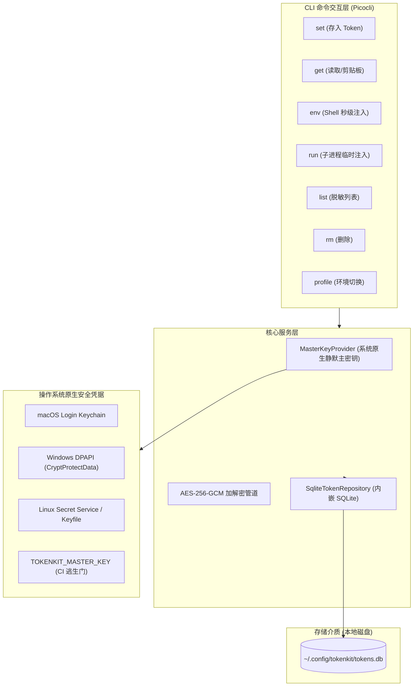

# TokenKit — 架构与设计规范 (Design Specification)

- **日期**：2026-10-17
- **状态**：已评审 (Approved)
- **作者**：lihu & Antigravity
- **关联实现模块**：`li-tools/tokenkit`
- **契约规格文件**：[tokenkit/SPEC.md](file:///Users/lihu/git/li-tools/.worktrees/tokenkit/tokenkit/SPEC.md)

---

## 1. 背景与目标 (Context & Objectives)

### 1.1 痛点诊断
开发者在日常开发中面临大量私密 Token 与 API Key 的管理需求（如 OpenAI、Anthropic、GitHub PAT、AWS、各类 SaaS 凭证）。现有方案普遍存在两极分化问题：
1. **明文散落**：直接将 Token 写入 `~/.zshrc`、`~/.bashrc` 或 `.env` 文件，导致屏幕分享泄露、git 意外提交、Shell 历史暴露等极高风险。
2. **重度交互阻断**：传统安全软件或密码管理器往往每次调用需要输入主密码或弹窗生物识别，与开发者“每秒可能开启一个终端并期望瞬间就绪”的高频使用习惯相冲突。
3. **平台割裂**：macOS、Windows 11、Linux 各自平台密钥存储 API 差异巨大，缺乏统一体验的轻量级 CLI 工具。

### 1.2 核心目标
- **易用性第一**：核心杀手功能 `tokenkit env` 支持在终端启动（如 `eval "$(tokenkit env)"`）时以毫秒级（< 10ms）速度静默注入当前环境变量，零弹窗、零打扰。
- **磁盘全加密**：以自包含内嵌式 SQLite 为存储引擎，Token 机密载荷采用 Java 25 原生 AES-256-GCM 强加密存储。
- **三端平权与静默授权**：
  - macOS：对接 Login Keychain，系统会话级静默授权；
  - Windows 11：对接 Windows DPAPI，强绑定当前登录用户；
  - Linux：对接 Secret Service 或受保护的本地 Machine Key（权限 0600）；
  - CI/CD：支持环境变量 `TOKENKIT_MASTER_KEY` 逃生门。
- **自包含零依赖**：基于 Java 25 + GraalVM Native Image 编译为单二进制文件，无需宿主机预装 JRE 或 SQLite。

---

## 2. 架构与组件设计 (Architecture & Components)

---

## 3. 数据持久化规范 (SQLite Schema)

数据库初始化时创建 3 张核心表：

1. **`vault_metadata`**：存放 schema 版本与金丝雀（Canary）验证密文。
2. **`profiles`**：环境分组（预置 `default` 并设为激活）。
3. **`tokens`**：Token 核心实体表，字段包含 `id`, `profile`, `name`, `kind`, `nonce`, `ciphertext`, `description`, `tags`, `expires_at`, `created_at`, `updated_at`。
   - 索引：`idx_tokens_profile_lookup (profile, name)`。

详见接口契约规范：[tokenkit/SPEC.md](file:///Users/lihu/git/li-tools/.worktrees/tokenkit/tokenkit/SPEC.md)。

---

## 4. 密码学与安全策略 (Cryptographic Specification)

- **算法**：`AES/GCM/NoPadding`（256 位密钥，12 字节强随机 Nonce，16 字节认证标签）。
- **Master Key 派生与存储**：
  - 由安全随机数发生器 `SecureRandom` 生成 32 字节高熵随机数。
  - 存放在系统原生安全层，避免用户反复输入密码。
- **防篡改与完整性校验**：
  - 任何针对 SQLite 密文字段的单比特篡改都会在 GCM 认证标签验证阶段直接触发 `AEADBadTagException`，杜绝伪造与损坏扩散。
- **内存安全**：
  - 敏感字节数组在完成加密/解密并输出后立即执行 `Arrays.fill(..., (byte)0)` 抹除。

---

## 5. 验收标准与测试矩阵 (Acceptance Criteria)

1. **单元测试 (Unit Tests)**：
   - `CryptoEngineTest`：验证 AES-256-GCM 正常加解密、篡改数据抛出异常、空/长/多行 PEM 载荷兼容性。
   - `MasterKeyProviderTest`：验证环境变量注入、本地文件保护及 Mock 系统调用。
   - `SqliteRepositoryTest`：验证 DDL 自动初始化、Token CRUD、联合唯一索引冲突处理、Profile 级联删除。
2. **端到端集成测试 (E2E Tests)**：
   - `tokenkit set OPENAI_API_KEY sk-test-123` 成功存入。
   - `tokenkit get OPENAI_API_KEY` 精确输出 `sk-test-123`。
   - `tokenkit env` 在 100 个 Token 规模下全量输出耗时 < 10ms，且格式兼容 Zsh、Bash 与 PowerShell。
   - `tokenkit run -- sh -c 'echo $OPENAI_API_KEY'` 成功在子进程打印环境变量。
3. **跨平台验证 (Cross-Platform Verification)**：
   - macOS (arm64 & x86_64) 本地运行与 Native Image 构建。
   - Windows 11 (x64) DPAPI 与 PowerShell 注入测试。
   - Linux (x86_64) XDG 规范路径与无头模式测试。
